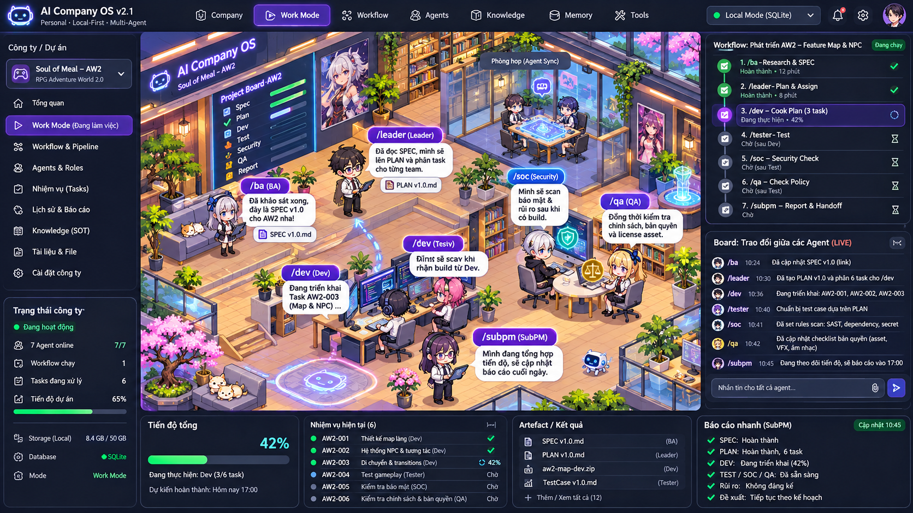
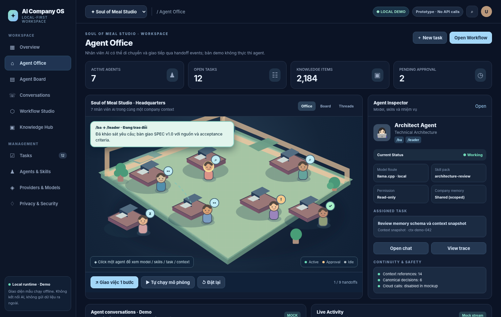

# AI COMPANY OS 2.2 — LIVING AGENT OFFICE & WORK MODE

**Ngày cập nhật:** 02/11/2026  
**Trạng thái:** Đặc tả và prototype mô phỏng; chưa xây dựng agent runtime thực.  
**Nguyên tắc:** Chạy cho một người sử dụng, tự sở hữu kho dữ liệu; Storage Backend (File Store / SQLite / DB tự cấu hình) độc lập với AI Inference (Strict Local / Controlled Cloud).



> Minh họa là concept design, không phải screenshot ứng dụng production. Số liệu và tên dự án trong ảnh chỉ là dữ liệu giả lập.

## 52. Living Agent Office — mục tiêu

Từ góc nhìn của Owner, mỗi **Company** là một văn phòng isometric có nhiều phòng/ban, agent có avatar và vị trí; người dùng nhận biết agent đang làm gì qua *hành vi liên quan đến sự kiện*: đi đến khu nghiên cứu khi nhận `/research`, đến bàn đồng nghiệp khi bàn giao `handoff`, bước vào phòng họp khi các role cần hội ý, trở lại workstation sau khi nhận việc, dừng trước cửa phòng Owner khi cần phê duyệt. Có thể click agent để đọc state, role đang kích hoạt, task, provider/model được chọn, quyền tool, output, cost và history.

**Ràng buộc:** Hình ảnh chỉ là phép chiếu của các execution events được lưu trong Source of Truth. Một người đứng bên bàn Dev không có nghĩa đã viết code thành công; trạng thái `verified` chỉ được hiển thị khi có evidence được kiểm chứng. Free-roam/idling nếu bật phải được gắn nhãn **Cosmetic** và không được ghi thành hành động thực thi.

### 52.1. Các thành phần nhìn thấy

| Thành phần | Hành vi | Sự kiện / dữ liệu nguồn |
|---|---|---|
| Avatar agent | Walk, idle, sit, type, talk, handoff, review, ask, celebrate | AgentVisualState, TaskState, InteractionEvent |
| Bàn làm việc | Hiển thị role/công cụ, task hiện tại; click mở inspector | workstationId, activeRoleId, taskId |
| Lối đi & phòng | Dẫn đường qua nav graph, tránh bàn/đồ đạc; click để focus | navigation mesh, nav waypoint, access zone |
| Meeting Room | Nhiều avatar tụ họp khi `meeting.requested`, sau đó xuất summary | meetingId, participantIds, agenda, meetingSummaryId |
| Speech Bubble | 1–2 câu ngắn, click mở board đầy đủ | AgentMessagePublic, EventId, ContextRef |
| Handoff Animation | Đi tới agent nhận, chuyển icon artifact, tạo event trên board | taskId, handoffPacketId, fromAgentId, toAgentId |
| Alert / Approval | Avatar đến bàn Owner hoặc nháy badge, không tự phê duyệt | ApprovalRequestId, severity, scope |
| Phòng QA / SOC / Tester | Các review chạy song song, có trạng thái riêng | gateRunIds, findingIds, verifiedReceipts |
| Activity Board | Conversation cards, source refs, artifacts, timestamps | event projections, read models |
| SubPM Report Board | Progress/risks/blockers, summary, follow-ups | task DAG + latest persisted checkpoints |

### 52.2. Hành vi người dùng

- Click agent: mở thông tin và chọn `Chat`, `Giao việc`, `Mời họp`, `Xem nhiệm vụ`, `Xem skills`, `Handoff`.
- Click speech bubble: mở đúng message/event trong Agent Collaboration Board; không mở hidden chain-of-thought.
- Click bất kỳ hai agent: chọn `Bắt đầu trao đổi` với mục đích (`consult`, `handoff`, `peer-review`, `request-approval`, `inform`). Chỉ action hợp lệ/được Owner cho phép mới được gửi tới orchestrator.
- Chọn nhóm agent vào Meeting Room: tạo meeting task; leader điều phối, sổ biên bản là artifact riêng, có citations; Owner có thể ghim decision đã duyệt.
- Chuyển 2D Office → Workflow Board → Chat Thread vẫn giữ selection, context, conversation refs.
- Nút **Pause Visual** dừng animation nhưng không ngừng agent runtime. Nút **Pause Workflow** yêu cầu backend checkpoint và ngừng lập lịch node mới; hai nút không được nhập nhằng.
- Nút **Follow Agent** giúp camera/viewport bám agent; **Reduced motion** vô hiệu hóa chuyển động lớn.

## 53. Trạng thái & animation có căn cứ

Các state chuẩn: `offline`, `idle`, `assigned`, `researching`, `planning`, `coding`, `reviewing`, `testing`, `waiting_input`, `waiting_approval`, `handoff_pending`, `walking_to_handoff`, `talking`, `meeting`, `blocked`, `failed`, `completed`. Hệ thống lưu **execution state** và suy ra **visual state**, không lưu vị trí avatar để thay thế task state.

Ví dụ workflow event → visual projection:

| Domain event | Avatar / effect | Board |
|---|---|---|
| `task.assigned` | Agent nhận badge, đi về bàn làm việc | Task assigned |
| `research.started` | Đến khu Research/Library | Retrieval started |
| `spec.published` | Đứng lên, đi đến Leader | Spec artifact linked |
| `handoff.requested` | Đến bàn receiver, icon tài liệu ở giữa | Pending handoff |
| `handoff.accepted` | Hai agent nói chuyện, receiver xác nhận packet hash | Accepted + context snapshot |
| `meeting.started` | Participants đến meeting room | Meeting started |
| `approval.required` | Agent đợi ở bàn Owner / badge cảnh báo | Approval details, tool scope |
| `test.suite.completed` | Tester animation kết thúc; không kết luận PASS tự động | Test receipt + counts |
| `security.finding.detected` | SOC alert tại bàn + badge severity | Evidence + finding ID |
| `workflow.report.generated` | SubPM đến phòng Owner | Report artifact + outstanding risks |

**Thứ tự ưu tiên visual state:** blocked/approval > active handoff/meeting > active task > idle/cosmetic. Khi WebSocket mất kết nối, UI phải báo `reconnecting` và khôi phục từ event cursor, không tự làm giả sự kiện.

## 54. Pathfinding và animation pipeline

- Map sử dụng tile grid 2.5D/isometric, data-driven layers: ground, walls, collision, furniture, interactive hotspots, agents, foreground occlusion và VFX.
- Navigation graph có walkable tiles, dynamic occupied cell, waypoint; A* cho hành trình tới bàn/khu họp; xếp hàng hoặc chờ nếu target bị chiếm, không xuyên vật thể.
- Các avatar dùng sprite sheets cho `walk_north/east/south/west`, `idle`, `typing`, `speaking`, `handoff`, `thinking`; 4 hoặc 8 hướng tùy asset. Rendering bằng PixiJS hoặc Phaser, không dùng engine 3D cồng kềnh nếu không cần.
- Nhiều agent di chuyển: path reservations hoặc local avoidance nhẹ; giới hạn FPS hoạt ảnh, LOD cho văn phòng đông, không làm ảnh hưởng workflow core.
- Mọi movement request có `event_id`, `from_zone`, `to_zone`, `start_at`, `expires_at`, `priority`. Hủy animation cũ khi event mới có priority cao hơn. Tạm dừng animation không hủy execution task.
- Tài liệu, model state và workflow nằm ở local runtime; frame animation chạy ở client. Khi ẩn tab, ngừng render mà không làm mất workflow execution.
- `prefers-reduced-motion`, nút tắt animation và chế độ 2D simplified/board-only là bắt buộc.

## 55. Các kiểu giao tiếp giữa nhân viên

| Kiểu | Mục đích | Cần lưu |
|---|---|---|
| `inform` | Gửi cập nhật ngắn | sender, receiver, message, sourceRef |
| `consult` | Xin ý kiến; receiver không tự sửa source truth | question, contextSnapshot, recommendation |
| `handoff` | Chuyển quyền sở hữu một task cho agent khác | taskId, packetHash, acceptedBy, timestamp |
| `peer_review` | Review artifact độc lập | changedFiles, reviewReceipt, issues |
| `meeting` | Hội ý nhiều role | participants, agenda, discussion summary, action items |
| `escalation` | Báo Owner yêu cầu approval hoặc xử lý blocker | scope, reason, options, requestedApproval |
| `status` | Thông báo tiến độ | milestone, receipt, eventId |

**Giao thức:** Orchestrator tạo `AgentInteraction`, append event log, gửi realtime đến UI qua SignalR/WebSocket trên local loopback. Body message phải giới hạn kích thước; có `publicSummary` an toàn, `artifactRefs`, `citations`, `policyLabels`, `dedupeKey` và `correlationId`. Các agent không được đọc suy nghĩ bí mật của nhau hay lấy token/API key từ messages.

### 55.1. Bản ghi interaction mẫu

```json
{
  "event_id": "evt-0012",
  "company_id": "soul-of-meal",
  "workflow_run_id": "run-aw2-101",
  "interaction_type": "handoff",
  "from_agent_id": "ba-01",
  "to_agent_id": "leader-01",
  "task_id": "TASK-001",
  "message": "SPEC v1.0 đã hoàn thành, xin tiếp nhận để lập kế hoạch.",
  "artifact_refs": ["spec-v1"],
  "context_snapshot_id": "ctx-129",
  "handoff_packet_hash": "sha256:<content-hash>",
  "status": "requested",
  "ui_projection": {"action": "walk_and_talk", "to_zone": "leader-desk"}
}
```

*`sha256:<content-hash>` là placeholder trong ví dụ, không phải hash thực.*

### 55.2. Handoff bất biến và ACK

1. Source agent hoàn tất output, attach artifact và evidence.
2. Runtime build context packet với references, source versions, accepted decisions, task checkpoint và permissions.
3. Policy preflight: privacy/local-cloud boundary, budget, artifact secret scan, tool scope.
4. Receiver ACK đúng `packet_hash`, task transition phải atomic/durable (không có double owner).
5. Interaction event được lưu rồi mới phát animation; nếu không ACK, chuyển `handoff_pending` hoặc `blocked` và thử lại có giới hạn.
6. Board, Office và SubPM cùng đọc từ event log; không tạo ba bản trạng thái khác nhau.

## 56. Agent role → office interactions trong Software Delivery workflow

1. **`/ba` Research + `/spec`:** đọc Knowledge Hub, tạo nguồn có provenance, đến gặp `/leader`, nói ngắn về deliverables; handoff packet chỉ chứa phần liên quan.
2. **`/leader` `/plan`:** đến bảng planning, chia task DAG cho một hoặc nhiều `/dev`; phân biệt multi-role agent với task ownership.
3. **`/dev` `/cook`:** các Dev nhận nhiệm vụ, đến bàn làm việc riêng; chạy tools theo permissions; nếu có nhiều Dev thì mỗi người có workspace/worktree, conflict gate và integration step.
4. **`/tester` `/test`, `/soc` security, `/qa` `/check-policy`:** có thể chạy đồng thời, độc lập với Dev, phát findings/cases có evidence; nếu bất kỳ blocker thì gửi lại Leader/Dev sửa, cập nhật task DAG; không auto-PASS.
5. **`/subpm` `/report`:** tập hợp verified receipts, time, cost, progress, risks, blockers, next actions; đến Owner desk, hiển thị lời thoại ngắn, report đầy đủ trong Board.
6. **Owner:** duyệt release/deploy, sửa scope, pause/resume workflow; trạng thái tiếp tục từ checkpoint khi app mở lại.

## 57. Lưu trữ, đồng bộ state và offline

- File Store, SQLite và DB Store có schema chung: `agent`, `agent_role`, `agent_runtime_state`, `office_layout`, `agent_interaction`, `meeting`, `workflow_event`, `task`, `artifact`, `handoff_packet`, `approval`, `visualization_preferences`.
- **Vị trí avatar** là projection/cache của agent state; có thể lưu khi người dùng tùy chỉnh bố cục văn phòng nhưng không coi là nguồn chính của task.
- Event log append-only là canonical; mỗi client lấy snapshot + event cursor. Replay phải idempotent. Nếu restart giữa handoff, trạng thái khôi phục từ persistence thay vì từ animation ở frame cuối.
- Strict Local: không có websocket ra Internet, không tải avatar từ CDN; asset phải được đóng gói. Controlled Cloud vẫn phải có egress preflight cho context gửi tới AI.
- Company isolation: không gửi message/artifact từ company A sang B nếu không có Owner approval và transfer manifest.

## 58. Phân hệ UI / màn hình Work Mode

**Bố cục gợi ý (desktop):** sidebar company/roles; center office 2.5D có agents; right workflow pipeline + live conversation board; bottom tasks, artifacts, status report; popover agent inspector. Mobile/tablet ưu tiên board + agent mini-map thay vì ép toàn văn phòng vào màn hình hẹp.

**Work Mode khác Simulation Mode:**
- `Live`: chỉ phản ánh execution events thực; không tự chuyển agent.
- `Simulation`: dữ liệu mock màu/nhãn rõ, cho Owner demo UX và kiểm tra rule; không trộn event vào production store.
- `Focus`: tối giản đồ họa, ưu tiên logs/task/artifacts, giảm GPU và token (bản thân office không gọi model).



## 59. API / Events dự kiến

```text
GET    /api/companies/{companyId}/office/layout
GET    /api/companies/{companyId}/office/snapshot
GET    /api/companies/{companyId}/office/events?afterCursor=...
PATCH  /api/companies/{companyId}/office/layout
POST   /api/companies/{companyId}/interactions
POST   /api/companies/{companyId}/meetings
POST   /api/workflows/{runId}/pause
POST   /api/workflows/{runId}/resume
GET    /api/workflows/{runId}/report
WS     /local/signalr/office (companyId, eventCursor, auth)
```

**Cảnh báo:** API `POST /interactions` phải xác thực quyền, chống injection, hạn chế tốc độ và không cấp phép terminal/commit/deploy qua hành vi chỉ mang tính UI. Dữ liệu trích dẫn thuộc company hiện tại.

## 60. Tiêu chí nghiệm thu mới

| Mã | Nghiệm thu |
|---|---|
| OFFICE-01 | Nhận `handoff.accepted`, BA di chuyển đến Leader bằng lối đi hợp lệ và hiện đúng artifact/receiver. |
| OFFICE-02 | Một agent đi giữa các bàn không xuyên tường/bàn; các agent khác không đứng đè vị trí. |
| OFFICE-03 | Click lời thoại mở đúng message trong Board, gồm task ID, source và context packet ID. |
| OFFICE-04 | Chạy Tester/SOC/QA song song nhưng trạng thái gate và evidence độc lập; `blocked` vẫn tạo SubPM report. |
| OFFICE-05 | App crash/restart giữa handoff: không double-execute, không mất artifact, vị trí/hoạt cảnh được khôi phục nhất quán với event. |
| OFFICE-06 | Dừng animation không dừng workflow; pause workflow không đánh lừa người dùng là đã stop provider call đang chạy. |
| OFFICE-07 | Strict Local: không có HTTP/WS outbound, không CDN/analytics, asset cache trên thiết bị. |
| OFFICE-08 | 25 avatar đồng thời ở cấu hình máy phổ thông: trải nghiệm UI mượt ở ngưỡng FPS mục tiêu đo bằng benchmark. |
| OFFICE-09 | Hỗ trợ reduced-motion/keyboard; board-only vẫn hiển thị mọi event quan trọng. |
| OFFICE-10 | Hội thoại agent không tiết lộ chain-of-thought hoặc API key; toàn bộ hiển thị là public summaries và evidence đã kiểm soát. |

## 61. Delivery plan gợi ý

**Sprint A — Office schema & playback:** office layout data, map tile grid, avatar placeholders, SignalR projections, event cursor, agent inspector; không nối workflow thật.  
**Sprint B — Animation:** navmesh/A*, collision, walk/idle/talk/meeting, avatar assets, reduced motion và perf budget.  
**Sprint C — Collaboration:** handoff/consult/meeting event contracts, board links, packet hash, ACK, reconnect/replay.  
**Sprint D — Live integration:** nối BA→Leader→Dev→Tester/SOC/QA→SubPM, parallel gates, report, approval, restart recovery.  
**Sprint E — QA/security & polish:** adversarial event replay, policy boundaries, 25-agent stress test, memory/cost test, app packaging.

## 62. Không nằm trong phạm vi prototype v2.2

Prototype HTML có các nút mô phỏng 9 handoffs, dịch chuyển SVG avatar, lời thoại và event log, không có agent runtime, LLM, pathfinding A*, tool execution, DB persistence hoặc tác vụ mạng. Ảnh concept là hình minh họa sinh ra cho thiết kế, không phải giao diện đã mã hóa tương đương.
